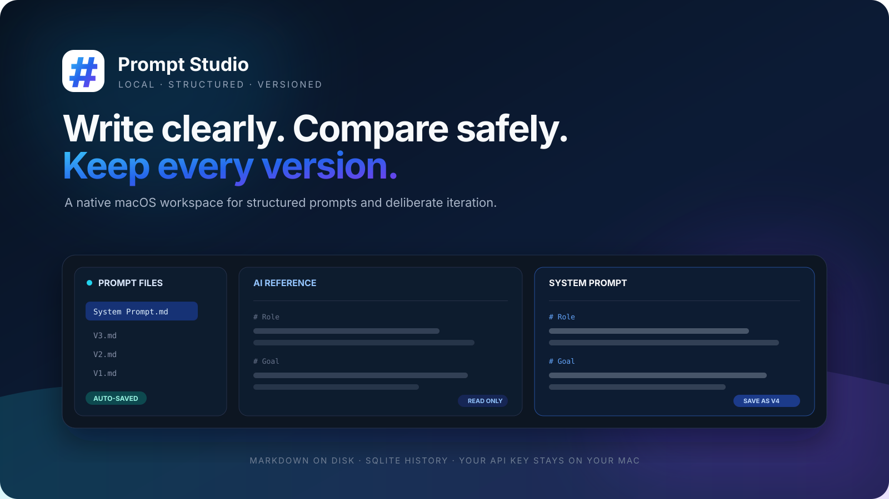

<p align="center">
  
</p>

<h1 align="center">Prompt Studio</h1>

<p align="center">
  面向结构化 Prompt 的本地原生 macOS 工作台。<br>
  写工作稿、与 AI 参考稿并排比较，并把每一次正式版本留在自己的电脑里。
</p>

<p align="center">
  <a href="LICENSE"></a>
  
  
  
  
</p>

<p align="center">
  <a href="#about">产品简介</a>
  ·
  <a href="#core-workflow">核心工作流</a>
  ·
  <a href="#features">当前能力</a>
  ·
  <a href="#data">文件与数据</a>
  ·
  <a href="#run-app">下载安装</a>
  ·
  <a href="#license">开源许可</a>
</p>

<p align="center">
  <a href="#core-workflow"></a>
</p>

<a id="about"></a>

## ✨ 这是什么

Prompt Studio 是一个原生、本地优先的 Prompt 编辑器。它把 Prompt 当作有结构的 Markdown 文档，而不是一段散落在聊天框里的文本：当前工作稿实时写回 `.md`，只有明确选择“保存新版本”时，才创建不可变的 `Vn.md` 历史快照。

当前仓库是第一阶段原型，重点验证从编辑、AI 辅助到版本回溯的完整闭环。

<a id="core-workflow"></a>

## 🧭 核心工作流

1. **组织** — 新建或打开本地 Prompt 文件夹，在左侧文件树管理结构化 Markdown 文档。
2. **比较** — 点击“AI 生成”，在只读 AI 参考稿与可编辑 System Prompt 之间逐段判断和修改。
3. **沉淀** — 草稿自动保存；确认成果后手动保存为新的不可变版本，随时预览、复制或基于旧版本继续编辑。

<a id="features"></a>

## 🧩 当前能力

| 能力 | 现在可以做什么 |
| --- | --- |
| 本地工作区 | 新建或打开 Prompt 文件夹；重命名、在 Finder 中显示或移到废纸篓 |
| 结构化编辑 | 默认生成 12 个维度；支持新增、删除、改名、隐藏与拖动排序 |
| AI 对照 | 使用 DeepSeek V4 Flash / V4 Pro 生成只读参考稿，与正式稿并排编辑 |
| 版本历史 | 创建连续的 `Vn.md` 快照，预览完整 Markdown，加入对比或基于旧版迭代 |
| 自动保存 | System Prompt 实时写回本地 Markdown；SQLite 仅保存版本和对照元数据 |
| 隐私边界 | API Key、接口地址和模型配置保存在当前 Mac 的应用偏好设置中，不写入 Prompt 或 App 包 |

<a id="data"></a>

## 🗂️ 文件与数据

每个 Prompt 都是一个独立文件夹，正文保持可读、可迁移的 Markdown 格式：

```text
My Prompt/
├── System Prompt.md              # 当前工作稿，自动保存
├── V3.md                         # 不可变历史快照
├── V2.md
├── V1.md
└── .prompt-history/
    └── workspace.db              # 版本与对照元数据
```

调试时可以通过 `--db <path>` 或环境变量 `PROMPT_ITERATION_DB` 指定隔离数据库。

<a id="run-app"></a>

## 🚀 下载安装

### [⬇️ 下载 Prompt Studio v0.1.0（Apple Silicon DMG）](https://github.com/yuanhao667/Prompt-Studio/releases/download/v0.1.0/Prompt.Studio.dmg)

点击上面的链接会直接下载 macOS 安装包。当前版本支持 Apple Silicon，要求 macOS 13 或更高版本。

1. 打开下载好的 `Prompt.Studio.dmg`。
2. 将 `Prompt Studio` 拖入“应用程序”文件夹。

### 首次打开

当前安装包尚未使用 Apple Developer ID 签名或提交 Apple 公证，因此第一次启动时可能会被 macOS 拦截：

1. 在“应用程序”中双击 `Prompt Studio`，让系统显示一次安全提醒。
2. 打开“系统设置 → 隐私与安全性”，向下滚动到“安全性”。
3. 找到关于 `Prompt Studio` 的提示，点击“仍要打开”。这个按钮会在首次尝试启动后出现。
4. 在再次弹出的确认窗口中点击“打开”；此后即可正常双击启动。

操作方法可参阅 [Apple 官方说明](https://support.apple.com/zh-cn/guide/mac-help/-mh40616/mac)。版本说明见 [Prompt Studio v0.1.0](https://github.com/yuanhao667/Prompt-Studio/releases/tag/v0.1.0)。

## 🙏 参考来源

SQLite 封装、事务写入和不可变版本思路改编自仓库内的 `prompt-version-manager` 参考实现。第三方许可与说明见 [THIRD_PARTY_NOTICES.md](THIRD_PARTY_NOTICES.md)。

<a id="license"></a>

## 📄 License

[MIT](LICENSE) — use it, fork it, ship it.

---

<p align="center">
  <strong>Built with ❤️ by <a href="https://github.com/yuanhao667">@yuanhao667</a></strong>
</p>

<p align="center">
  <a href="https://github.com/yuanhao667/Prompt-Studio/releases/download/v0.1.0/Prompt.Studio.dmg">Download for macOS</a>
  ·
  <a href="https://github.com/yuanhao667/Prompt-Studio/releases/tag/v0.1.0">Release Notes</a>
  ·
  <a href="https://github.com/yuanhao667/Prompt-Studio/issues">Report Issues</a>
</p>
